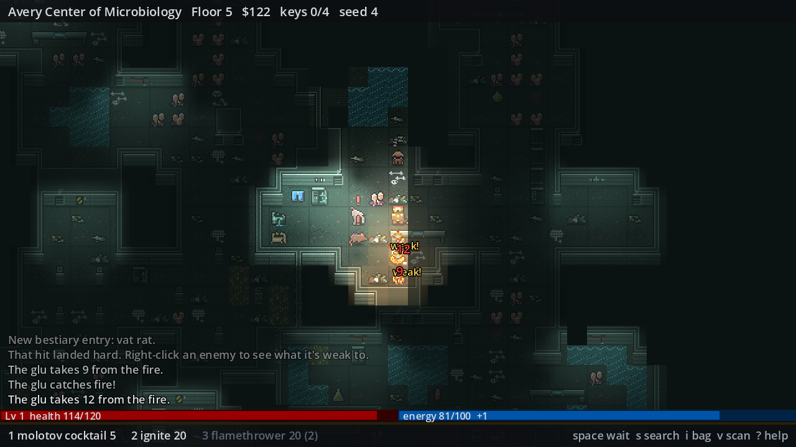
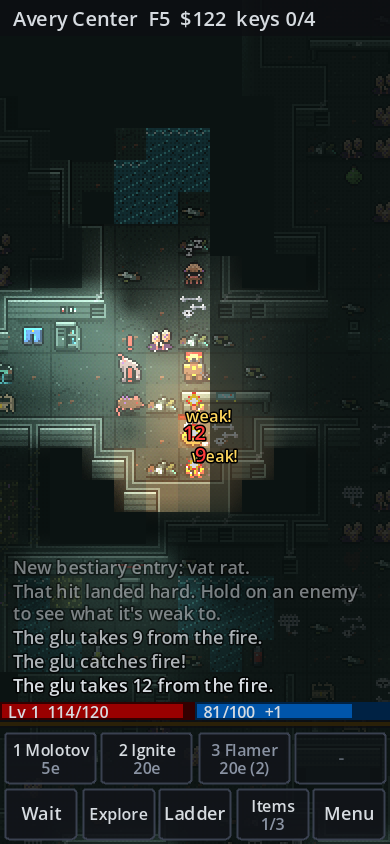

# Kepler 452b
K452b is a free roguelike RPG. The old desktop downloads have been retired while the game is rebuilt to play in the browser at [kepler452b.twinspear.com](https://kepler452b.twinspear.com). This guide will be updated for the new version when it launches.

Suggestions, Bugs & Feedback Welcome [here.](https://github.com/NathanielInman/kepler452b/issues)

  
  

## Table of Contents
- [Story](#story)
- [Basics](#basics)
  * [Movement](#movement)
  * [Purchasable Upgrades](#purchasable-upgrades)
  * [Classes & Abilities](#classes-&-abilities)
    * [Mercenary](#mercenary)
    * [Captain](#captain)
    * [Agent](#agent)
    * [Doctor](#doctor)
    * [Cannoneer](#cannoneer)
    * [Pyrotechnic](#pyrotechnic)
    * [Assassin](#assassin)
    * [Scientist](#scientist)
  * [Items](#items)
  * [Quests](#quests)
  * [Traps](#traps)

## Story
You are on the Cygnas System exploration regiment, sent 1400 light-years away from Earth to explore and take samples from the planet Kepler-452b, a super earth exoplanet in the habitable zone of a G2 star discovered 827 years ago today on August 23rd, 2015. You are one of 5 captains, your battalion having been the last to wake from cold sleep. The E-Class Starship Yuri has been orbiting K452b for almost 10 years now and communications with First Battalion at the forward operating base have been unanswered for the last two weeks.

The terminal manifest has uprooted audio logs of battalion staff officers having to suppress rumors of creatures native to K452b being grown and dissected. The only lead scientist aboard Yuri has noted that for the past 4 months the planet has begun to pulse strong wave emulsions that could directly be interfering with any wide-band communications.

Upon setting boots on ground, it's clear that the entire forward operating base has been compromised. In order to return home you have to retrieve all missing ship access keys from the other four captains. Gain the upper hand by acquiring more intel or methodically destroy any opposition to gain power. Command your team to whatever style suits you. It will take many lives to restore the balance, it'll only take a few to escape.

## Basics

1. There are four ways to beat the game, find all 4 keys for game ending #1
2. Discover all intel for game ending #2
  - Some intel will unlock new classes
3. Use 's' key to navigate more easily when no enemies are around
4. Acquire money and upgrade units between runs
  - Increasing item quality and amount will greatly ease runs
5. Sneaking past Planck Research without finding the 4 keys will unlock game ending #3
  - Haldane Terminus unlocks after finding all 4 keys
6. Conquering The Ruined Beyond unlocks the final game ending #4

### Movement

- **Moving South**: j, down arrow
- **Moving East**: l, right arrow
- **Moving West**: h, left arrow
- **Moving North**: k, up arrow
- **Moving Northwest**: y
- **Moving Southwest**: b
- **Moving Northeast**: u
- **Moving Southeast**: n
- **Downwards**: >
  - This will climb down a ladder to the next level. You cannot go backwards in K452b
- **Open Door, Close Door**: o, then press direction
- **Autosearch**: s
  - This will move the character automatically until target search item is found or enemy shows up
- **Activate, Shoot, Rest**: Spacebar
- **Primary Skill**: 1
  - Some skills will require you to press a direction or select an enemy
- **Secondary Skill**: 2
  - Some skills will require you to press a direction or select an enemy
- **Tertiary Skill**: 3
  - Some skills will require you to press a direction or select an enemy
- **Help Screen**: ?

### Purchasable Upgrades
Throughout gameplay you acquire money that can be used in-between games to increase the effectiveness of your units you control on each run. All costs below are base cost where each attribute may be upgraded an infinite amount of times with the cost doubling with each purchase. It is expected that characters may eventually become invulnerable to damage with enough upgrades.

- **+1 Damage** - $1000
- **+1 Defense** - $1000
- **+10 Max Health** - $800
- **+10 Max Energy** - $800
- **+5% Dodge** - $800
- **+5% Critical Hit** - $800
- **+10% Items** - $500
- **+10% Item Quality** - $500

### Classes & Abilities
All characters start with 100 health and 100 energy.

#### Mercenary

1. **Energy Pistol**
  - Basic ranged attack deals 1d8 damage
  - Costs 5EN
2. **E-Vision**
  - For 20 rounds greatly increase field of view and subsequent shooting distance
  - Costs 25EN
3. **Hyper Rifle**
  - Basic ranged attack deals 2d12 splash damage to an area
  - Costs 15EN

#### Captain

1. **Laser**
  - Basic ranged attack deals 1d6 damage
  - Costs 5EN
2. **Dash**
  - Jump up to 4 tiles, has a cooldown of 4 rounds between uses
  - Costs 10EN
3. **Lay Mine**
  - Lay a mine on the ground that deals 2d20 splash damage to a large area when walked upon by enemies or player
  - Costs 40EN

#### Agent

1. **Energy Pistol**
  - Basic ranged attack deals 1d8 damage
  - Costs 5EN
2. **Sneak**
  - Move around without being heard or seen, cannot be used in battle
  - Costs 8EN per round while active
3. **Backstab**
  - Basic melee attack that requires stealth to use
  - Costs 15EN

#### Doctor

1. **Laser Scalpel**
  - Basic ranged attack deals 1d4 damage
  - Costs 5EN
2. **Heal**
  - Heal oneself for 5d4, has a cooldown of 5 rounds between uses
  - Costs 30EN
3. **Hide**
  - Cannot be seen. Must remain still to remain in stealth. Cannot be used in battle.
  - Costs 40EN

#### Cannoneer

1. **Concord Blast**
  - Basic ranged attack deals 2d6 damage
  - Costs 5EN
2. **Energize**
  - Increase EN by 30, has a cooldown of 5 rounds between uses
  - No Cost
3. **Disintegrate Cannon**
  - Basic ranged attack deals 5d8 splash damage to a medium-sized area
  - Costs 50EN

#### Pyrotechnic

1. **Molotov Cocktail**
  - Basic ranged attack catches target ground on fire and deals 1d4 damage to those on-top of ground for 5 rounds.
  - Costs 5EN
2. **Cold Salve**
  - Heal for 2d4, has a cooldown of 3 rounds between uses
  - Costs 20EN
3. **Flamethrower**
  - Basic ranged attack catches all ground between target and pyrotechnic on fire and deals 1d4 to those on-top of said ground for 5 rounds
  - Costs 20EN

#### Assassin

1. **Throw Knife**
  - Basic ranged attack deals 1d4 damage
  - Costs 5EN
2. **Jump Shadows**
  - Escape combat immediately and go to sneak stealth
  - Costs 35EN
3. **Backstab**
  - Basic melee attack deals 1d20 damage
  - Costs 15EN

#### Scientist

1. **Grapple**
  - Basic ranged attack deals 1d4 damage and pulls enemy to the scientist
  - Costs 5EN
2. **Needle**
  - Basic melee attack deals 5d2 damage
  - Costs 15EN
3. **Infect**
  - Basic melee attack deals 1d6 damage to enemy and poisons for 1d4 damage per round for 10 rounds.
  - Costs 15EN

### Items

- First, Second, Third & Fourth Captain Keys
  - Game win scenario 1
- First intel
  - Game win scenario 2 1/8
  - Unlocks captain class
- Second intel
  - Game win scenario 2 2/8
  - Unlocks agent class
- Third intel
  - Game win scenario 2 3/8
  - Unlocks agent class
- Fourth intel
  - Game win scenario 2 4/8
  - Unlocks cannoneer class
- Fifth intel
  - Game win scenario 2 5/8
  - Unlocks pyrotechnic class
- Sixth intel
  - Game win scenario 2 6/8
  - Unlocks assassin class
- Seventh intel
  - Game win scenario 2 7/8
  - Unlocks scientist class
- Eighth intel
  - Game win scenario 2 8/8
- Red Medpack
  - Increase health by 50%
- Blue Medpack
  - Increase energy by 50%
- Green Medpack
  - Increase health and energy by 25%
- Bandage
  - Increase health by 25%
- Health Potion
  - Increase health by 25%
- Energy Potion
  - Increase energy by 25%
- Health & Energy Potion
  - Increase health and energy by 10%
- Chicken
  - Increase health by 5%
- Pizza
  - Increase helath by 5%
- Brown Candy Bar
  - Increase energy by 5%
- Blue Candy Bar
  - Increase energy by 10%
- Open Blue Candy Bar
  - Increase energy by 5% decrease health by 5%
- Open Red Candy Bar
  - Increase energy by 5% decrease health by 5%
- Damage Boost Syringe
  - Boost current game base damage by 1
- Health Boost Syringe
  - Boost current game maximum health by 20
- Energy Boost Syringe
  - Boost current game maximum energy by 20
- Health Battery
  - Increase health by 100% allowing overcharge
- Energy Battery
  - Increase energy by 100% allowing overcharge
- Health & Energy Battery
  - Increase health and energy by 50% allowing overcharge
- Health & Energy Erlenmeyer Flask
  - Give +5 to health and energy every round for 10 rounds without overcharging
- Energy Recharge Erlenmeyer Flask
  - Give +10 to energy every round for 10 rounds without overcharging
- Health Recharge Erlenmeyer FLask
  - Give +10 to health every round for 10 rounds without overcharging
- Copper Coin
  - $1
- Silver Coin
  - $10
- Gold Coin
  - $100
- Dodge Ability Crystal (UNIQUE-ONLY-ONE)
  - Adds 10% chance to dodge for current game
- Health Regeneration Crystal (UNIQUE-ONLY-ONE)
  - Unlocks natural health regeneration for current game: increase health by 1 every round
- Energy Regeneration Crystal (UNIQUE-ONLY-ONE)
  - Unlocks natural energy regeneration for current game: increase energy by 1 every round
- Critical Strike Cyrstal (UNIQUE-ONLY-ONE)
  - Adds 10% chance to critical strike (x2 damage) for current game
- Blocking Ability Crystal (UNIQUE-ONLY-ONE)
  - Adds 10% chance to block an attack for current game
- Gray Helmet (UNIQUE-ONLY-ONE)
  - Increase defense by 1
  - (SET-BONUS) Gives 5 energy each kill
- Gray Chestplate (UNIQUE-ONLY-ONE)
  - Increase defense by 1
  - (SET-BONUS) Gives 5 energy each kill
- Gray Gloves (UNIQUE-ONLY-ONE)
  - Increase defense by 1
  - (SET-BONUS) Gives 5 energy each kill
- Gray Pants (UNIQUE-ONLY-ONE)
  - Increase defense by 1
  - (SET-BONUS) Gives 5 energy each kill
- Gray Boots (UNIQUE-ONLY-ONE)
  - Increase defense by 1
  - (SET-BONUS) Gives 5 energy each kill
- Blue Helmet (UNIQUE-ONLY-ONE)
  - Increases maximum energy by 20
  - (SET-BONUS) Damage received takes from energy before health
- Blue Chestplate (UNIQUE-ONLY-ONE)
  - Increases maximum energy by 20
  - (SET-BONUS) Damage received takes from energy before health
- Blue Gloves (UNIQUE-ONLY-ONE)
  - Increases maximum energy by 20
  - (SET-BONUS) Damage received takes from energy before health
- Blue Pants (UNIQUE-ONLY-ONE)
  - Increases maximum energy by 20
  - (SET-BONUS) Damage received takes from energy before health
- Blue Boots (UNIQUE-ONLY-ONE)
  - Increases maximum energy by 20
  - (SET-BONUS) Damage received takes from energy before health
- Red Helmet (UNIQUE-ONLY-ONE)
  - Increases maximum health by 20
  - (SET-BONUS) Each use of primary skill increases health by 5
- Red Chestplate (UNIQUE-ONLY-ONE)
  - Increases maximum health by 20
  - (SET-BONUS) Each use of primary skill increases health by 5
- Red Gloves (UNIQUE-ONLY-ONE)
  - Increases maximum health by 20
  - (SET-BONUS) Each use of primary skill increases health by 5
- Red Pants (UNIQUE-ONLY-ONE)
  - Increases maximum health by 20
  - (SET-BONUS) Each use of primary skill increases health by 5
- Red Boots (UNIQUE-ONLY-ONE)
  - Increases maximum health by 20
  - (SET-BONUS) Each use of primary skill increases health by 5
- Stealth Helmet (UNIQUE-ONLY-ONE)
  - Increases melee damage by 1
  - +5% chance to critical strike
  - (SET-BONUS) Dodge increased by 30%
- Stealth Chestplate (UNIQUE-ONLY-ONE)
  - Increases melee damage by 1
  - +5% chance to critical strike
  - (SET-BONUS) Dodge increased by 30%
- Stealth Gloves (UNIQUE-ONLY-ONE)
  - Increases melee damage by 1
  - +5% chance to critical strike
  - (SET-BONUS) Dodge increased by 30%
- Stealth Pants (UNIQUE-ONLY-ONE)
  - Increases melee damage by 1
  - +5% chance to critical strike
  - (SET-BONUS) Dodge increased by 30%
- Stealth Boots (UNIQUE-ONLY-ONE)
  - Increases melee damage by 1
  - +5% chance to critical strike
  - (SET-BONUS) Dodge increased by 30%
- Quality Ammunition
  - Double all skill damage for 100 rounds
- Improved Laser Scalpel (UNIQUE-ONLY-ONE) (DOCTOR-ONLY)
  - Remove primary skill cost for laser scalpel
- Improved Grapple Hook (UNIQUE-ONLY-ONE) (SCIENTIST-ONLY)
  - Remove primary skill cost for grapple hook
- Improved Hyper Rifle (UNIQUE-ONLY-ONE) (MERCENARY-ONLY)
  - Reduce tertiary skill cost for hyper rifle by 5EN
- Improved Concord (UNIQUE-ONLY-ONE) (CANNONEER-ONLY)
  - Remove primary skill cost for concord
- Improved Energy Pistol (UNIQUE-ONLY-ONE) (AGENT-OR-MERCENARY-ONLY)
  - Remove primary skill cost for energy pistol
- Improved Throwing Knife (UNIQUE-ONLY-ONE) (ASSASSIN-ONLY)
  - Remove primary skill cost for throwing knife
- Improved Flamethrower (UNIQUE-ONLY-ONE) (PYROTECHNIC-ONLY)
  - Reduce tertiary skill cost for flamethrower by 5EN
- Improved Disintegrate Cannon (UNIQUE-ONLY-ONE) (CANNONEER-ONLY)
  - Reduce tertiary skill cost for disintegrate cannon by 20EN
- Improved Laser (UNIQUE-ONLY-ONE) (CAPTAIN-ONLY)
  - Remove primary skill cost for laser
- Improved Molotov Cocktail (UNIQUE-ONLY-ONE) (PYROTECHNIC-ONLY)
  - Remove primary skill cost for molotov cocktail

### Quests
There are 3 main quests, each with its own unique ending:

1. Gather all captains keys
2. Gather all intel
3. Clear all areas

There are also a variety of side quests available within the game:

- Break some barrels
- Break some boxes
- Open some crates
- Break some eggs
- Turn some servers on
- Turn some servers off
- Search some cabinets
- Sleep in a bed
- Kill some AMP Antecedent
- Loot some coins
- Find the gray/green/blue/red intel disk
- Find the green/red/yellow/purple access card
- Find the gask mask
- Find the hyper radio
- Find the shovel
- Find the hyper magnet
- Find the bag of rare materials
- Find the remains of the lost scout
- Find the energy sword
- Find the utlra energy sword
- Find the frag grenade
- Find the gas canister
- Find the riot shield
- Find the handheld medical unit
- Find the coil of optic fiber
- Find the fusion sphere
- Find the void lord/overlord/ether lord egg
- Trigger a trap

### Traps
Each type of trap has two possible qualities:

1. Basic traps have a 3x3 radius and deal 3d20 damage
2. Advanced traps have a 9x9 radius and deal 2d20 damage

- fire explosion trap
- ice explosion trap
- energy explosion trap
- ether explosion trap
- laser attack trap
- laser explosion trap
- poison trap
