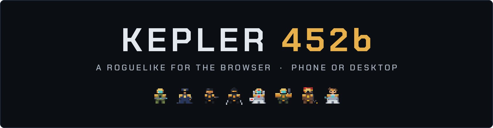
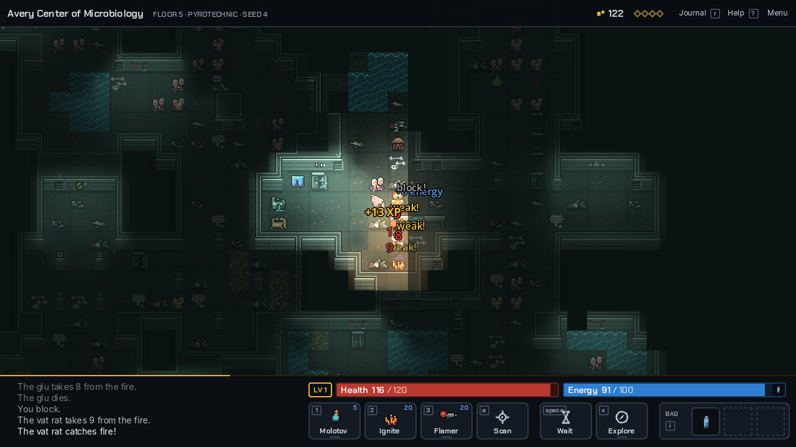
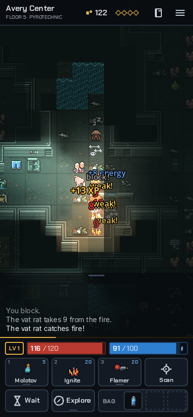
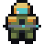
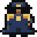
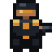
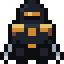
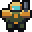
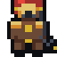

  

  

  
  
  
  

First Battalion went silent two weeks ago and the base below is lost. You go down after them, one floor at a time, and the only way out is to recover the four missing captain keys.

<table align="center">
  <tr>
    <td align="center"></td>
    <td align="center"></td>
  </tr>
  <tr>
    <td align="center"><b>Desktop</b>: keyboard and mouse</td>
    <td align="center"><b>Phone</b>: touch controls</td>
  </tr>
</table>

| Every run counts | Eight classes | Thumbs or keys |
|---|---|---|
| Every run starts fresh, but the credits you bring back buy upgrades at the base, and intel, classes and areas stay unlocked. Close the tab mid-run and **Continue Run** picks it up. | Each one carries a weapon, a skill and a device. The pyrotechnic can't be hurt by fire, and the assassin's shadow jump sets up a sure critical. | Tap, hold and drag on a phone. Keys, the mouse and the same drags on a desktop. Neither one gets a lesser game. |

## How to play

Everything below is folded so the page stays short. Open what you need.

<b>Controls</b>

 

Every control does its everyday thing on a tap. Holding one shows its choices and dragging picks one: the route, the aim or what an item would restore shows before you let go, and letting go on the dock cancels.

| To | On a phone | On a keyboard |
|---|---|---|
| Move or attack | Tap a tile you've seen, or an enemy beside you | Arrows, `hjkl`/`yubn` or the numpad; bump to attack |
| Wait | Tap yourself, or Wait | `space` |
| Use an ability | Tap it, or drag it onto the map to aim and fire | `1` `2` `3`; hold one and click a target to fire at once |
| Go down, sleep, open a door | The context button | `e` |
| Explore the floor | Tap Explore; hold it for Ladder, Bed or Crate | `x` (hold it for the same choices), `>` for the ladder |
| Draw a route | Press on yourself and drag | The same, with the mouse |
| Use an item | Tap a bag slot, or drag it onto yourself | `i`, or drag it with the mouse |
| Drop an item | Drag a bag slot onto the map | The same, with the mouse |
| Scan anything | Hold your finger on it | `v`, or right click |
| Read the log | Tap it, or swipe it up | `m` |
| Open the journal | Journal, in the top bar | `r` |

The context button changes with where you stand: Down on a ladder, Sleep on a bed, Open or Close next to a door, Enter lab next to a sealed lab, and Scan when none of those apply. `?` lists every key.

<b>The eight classes</b>

 

Every class carries a **weapon** on 1, a **skill** on 2 that never changes, and a **device** on 3. Melee weapons cost no energy; ranged ones do. Weapons and devices are items too, so equipping a better one you find (a turn) swaps it with the one you carry.

| | Class | Weapon | Skill | Device |
|---|---|---|---|---|
|  | Mercenary | Energy pistol: pierces everything in a line | Adrenaline: two actions for every enemy turn | Hyper rifle: a blast that stuns |
|  | Captain | Laser | Dash: free, then still act | Mine layer: shoot a mine to set it off |
|  | Agent | Stiletto: brutal from stealth | Sneak | E-vision goggles |
|  | Assassin | Throwing knives: sometimes stun | Shadow jump: free, then a sure critical | Toxin injector: poisons and slows |
|  | Doctor | Laser scalpel | Heal | Cloak |
|  | Cannoneer | Concord | Energize | Disintegrate cannon |
|  | Pyrotechnic | Molotov cocktail: fire that sticks | Ignite | Flamethrower |
|  | Scientist | Needle | Grapple: pulls and stuns | Cryo spray: bites while they're held |

> [!TIP]
> The pyrotechnic can't be hurt by fire, so standing in your own flames is a plan, not a mistake.

<b>Health, energy and the bag</b>

 

Energy is for the fight in front of you. It refills while nothing is chasing you and comes back with every kill. Health is for the whole run: it only comes back from what you carry and from beds, and every floor has at least one bed.

Your **bag** holds three things: heals, food, batteries, flasks and spare weapons or devices. Coins, keys, intel, syringes, crystals and armour don't take a slot; they work the moment you pick them up. Tap the health or energy bar to use the best thing you carry for it. Below a quarter health a heal gets used for you, unless you turn that off in Settings.

A full bag shows a card when you step on something new: leave one of the three behind, or leave the new thing where it is.

<b>Vials and damage types</b>

 

Potions are **vials**, and their colours change every run. A green vial might heal you this run and drain your energy the next. Drink one to learn what that colour does, or walk into a terminal and it analyzes everything in your bag. Three of the six are bad news, and auto-use never drinks a vial you don't know.

Every attack has a type: kinetic, energy, fire, poison, frost or pulse. Each family of enemies takes half again from one type and half from another. Hits say **weak!** or **resists**, and a scan names both. The base's machines short out on energy, which is a good reason to keep an energy weapon around early. Armour works the other way: each piece of a set shaves 10% off its set's type, so a full gray set halves kinetic hits.

<b>Getting stronger</b>

 

Kills and new floors give XP, and every level adds health and energy. Every second floor, and every area lord you kill, deals three **upgrade cards**: make your weapon, skill or device hit harder, cost less or come back sooner. The upgrade belongs to the slot, so it keeps working when you swap what's in it.

Credits carry over between runs and buy permanent upgrades at the base. The **fabricator** on each area's fourth floor spends the same credits on gear, so every purchase is this run against every run after.

<b>The way down</b>

 

| | Area | What waits there |
|---|---|---|
| 1 | Forward Operating Base | First Battalion's base. Its own machines hold it now. |
| 2 | Avery Center of Microbiology | Seeded and grown. The civilians' last refuge. |
| 3 | GSU Atilla | The garrison fell here. The AMP Antecedent stayed. |
| 4 | Planck Research | Where blackstone was made, and tested on prisoners. |
| 5 | Haldane Terminus | People came here in handcuffs. None left. |
| 6 | The Ruined Beyond | Below the facilities: the pulse itself. |

Each area has six floors and a lord waiting by the last ladder. Floor 3 of each area has a **sealed lab**: walk in for harder enemies and a cache of gear by its ladder, and that ladder brings you back where you left. Leaving Planck Research takes all four captain keys. Without them the run ends there.

<b>The story so far</b>

 

You are on the Cygnas System exploration regiment, sent 1400 light-years away from Earth to explore and take samples from the planet Kepler-452b, a super earth exoplanet in the habitable zone of a G2 star discovered 827 years ago today on August 23rd, 2015. You are one of 5 captains, your battalion having been the last to wake from cold sleep. The E-Class Starship Yuri has been orbiting K452b for almost 10 years now and communications with First Battalion at the forward operating base have been unanswered for the last two weeks.

The terminal manifest has uprooted audio logs of battalion staff officers having to suppress rumors of creatures native to K452b being grown and dissected. The only lead scientist aboard Yuri has noted that for the past 4 months the planet has begun to pulse strong wave emulsions that could directly be interfering with any wide-band communications.

Upon setting boots on ground, it's clear that the entire forward operating base has been compromised. To return home you have to retrieve all missing ship access keys from the other four captains.

## Feedback

Found a bug or have an idea? [Open an issue](https://github.com/theoestudio/kepler452b/issues). The game posts one anonymous row per run (no player id, no seed) so I can see where runs end, and nothing in it points back to you.

Made by <a href="https://twinspear.com">Twinspear</a> · <a href="https://nathanielinman.com/games">More games</a>

